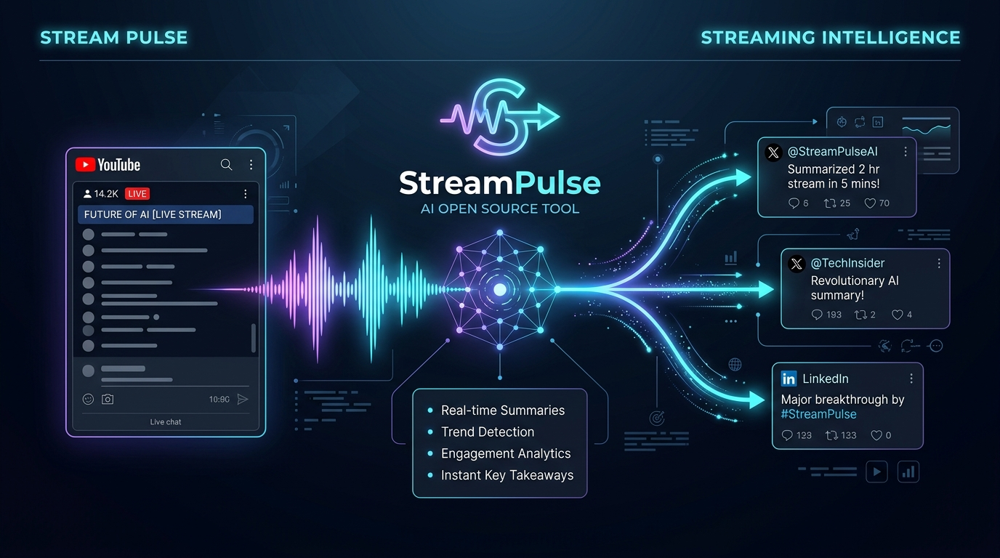
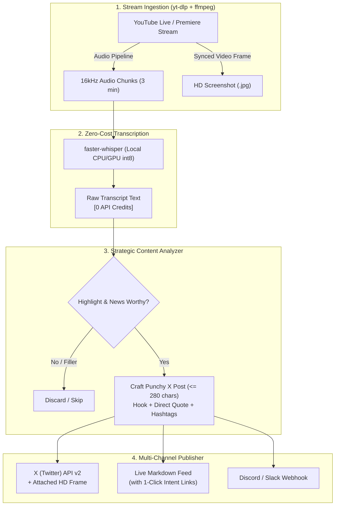

<div align="center">

# ⚡ StreamPulse AI

### Autonomous Real-Time YouTube Live & Premiere to X (Twitter) Agent
**Zero-API-Waste Live Blogging • Local Neural Speech-to-Text • Intelligent Frame Snapping**

[](https://opensource.org/licenses/MIT)
[](https://www.python.org/downloads/)
[](https://github.com/SYSTRAN/faster-whisper)
[](https://developer.twitter.com/)
[](https://github.com/Pikaswelt/streampulse/pulls)

<br />



</div>

---

## 💡 The Problem: Why Traditional Video LLMs Burn Cash

Streaming an entire 1-hour 1080p YouTube video or Premiere directly into multimodal LLM APIs burns **hundreds of thousands of video tokens**, costing tens of dollars per stream and frequently hitting token rate limits.

**StreamPulse** solves this with a **zero-waste, text-first architecture**:
1. 🎧 **Local / Free Audio Ingestion:** Grabs YouTube Live audio chunks or captions via `yt-dlp`.
2. 🎙️ **Offline Neural Transcription:** Transcribes using **`faster-whisper`** (CPU/GPU int8 quantization) — **0 API credits used**.
3. 🧠 **Smart Highlight Scoring:** Accumulates rolling transcript batches (every 3 mins) and filters out filler, banter, and pauses.
4. 📸 **Instant Screenshot Snapping:** Only when a true breakthrough or announcement is detected, it cuts an HD frame from the live video.
5. 🚀 **Auto-Publish to X (Twitter):** Posts directly via Twitter API v2 or generates 1-click Markdown publish cards.

---

## 🏗️ Architecture



---

## ✨ Features

- ⚡ **Zero API Waste:** Local Whisper transcription costs 0 API tokens; LLM text prompts are compact and filtered.
- 🎯 **Noise Reduction:** Automatically detects and skips stream pauses, intros, sponsor reads, and filler chatter.
- 📸 **Automated Visual Proof:** Captures the exact high-res frame from the video stream at the time of the highlight and embeds it with the tweet.
- 🔀 **Multi-Provider LLM Engine:** Supports **Google Gemini**, **Groq (Llama 3)**, **OpenAI**, and **local Ollama**.
- 🛡️ **Twitter Rule Compliance:** Calculates length with URL normalization (23-character rule) ensuring every post stays strictly under 280 characters.
- 📋 **Live Markdown Dashboard:** Creates a real-time `output/live_feed.md` file featuring timestamps, screenshots, and 1-click post buttons even if you haven't configured Twitter API keys yet.

---

## 🚀 Quick Start

### 1. Prerequisites
Ensure you have `ffmpeg` installed on your machine:
```bash
# Ubuntu / Debian
sudo apt update && sudo apt install -y ffmpeg

# macOS
brew install ffmpeg
```

### 2. Installation
```bash
git clone https://github.com/Pikaswelt/streampulse.git
cd streampulse

pip install -r requirements.txt
```

### 3. Configure Credentials (Optional)
Copy the example environment file:
```bash
cp .env.example .env
```
Add your desired LLM key (e.g. `GEMINI_API_KEY`) and optional Twitter API keys:
```env
GEMINI_API_KEY=AIzaSy...
TWITTER_CONSUMER_KEY=...
TWITTER_CONSUMER_SECRET=...
TWITTER_ACCESS_TOKEN=...
TWITTER_ACCESS_TOKEN_SECRET=...
```
*(If no Twitter keys are provided, StreamPulse operates in **Interactive 1-Click Mode**, giving you instant web-intent links to publish each post with one click).*

---

## 💻 Usage

### Monitor a Live Stream or Premiere
```bash
python3 run.py run "https://www.youtube.com/watch?v=YOUR_VIDEO_ID"
```

### Options & Flags
| Flag | Short | Default | Description |
|---|---|---|---|
| `--interval` | `-i` | `180` | Duration of audio chunk in seconds before running analysis |
| `--whisper-model` | `-w` | `base` | Whisper model size (`tiny`, `base`, `small`, `medium`) |
| `--provider` | `-p` | `gemini` | LLM provider (`gemini`, `groq`, `openai`, `ollama`) |
| `--llm-model` | `-m` | `gemini-1.5-flash` | Specific model name |
| `--dry-run` | | `False` | Run analysis and frame capture without publishing to X |
| `--topic` | `-t` | None | Set custom stream context (e.g. "Apple Keynote", "SpaceX Launch") |
| `--tone` | | None | Customize tone (e.g. "humorous", "breaking-news", "technical") |
| `--webhook` | | None | Discord or Slack webhook URL for real-time alerts |

### Example: High-Speed Tech Keynote Mode
```bash
python3 run.py run "https://www.youtube.com/watch?v=..." \
  --interval 120 \
  --provider gemini \
  --topic "AI Keynote 2026" \
  --tone "breaking-news, technical, insightful"
```

---

## 📂 Project Structure

```
streampulse/
├── docs/
│   └── assets/
│       └── banner.png       # High-resolution tool banner
├── streampulse/
│   ├── __init__.py
│   ├── analyzer.py          # AI highlight detection & post crafter
│   ├── cli.py               # Rich CLI command interface
│   ├── config.py            # Environment & runtime configuration
│   ├── publisher.py         # X API v2, Webhook & Markdown feed generator
│   ├── stream.py            # yt-dlp & ffmpeg stream capture engine
│   ├── transcriber.py       # faster-whisper local transcription
│   └── utils.py             # Character counters & formatting utilities
├── tests/
│   └── test_analyzer.py     # Unit test suite
├── .env.example
├── LICENSE                  # MIT License
├── pyproject.toml
├── requirements.txt
├── README.md
└── run.py                   # Root runner
```

---

## 🧪 Running Tests
```bash
python3 -m unittest discover -s tests -p "test_*.py"
```

---

## 🤝 Contributing
Contributions are welcome! Please open an issue or submit a pull request.

---

## 📄 License
This project is licensed under the [MIT License](LICENSE) © 2026 Pikaswelt.
